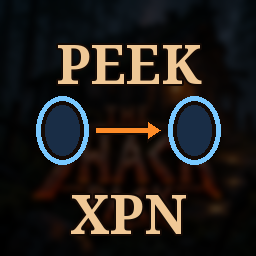

# PortalPeek XPN Bridge

**[Download on Thunderstore](https://thunderstore.io/c/valheim/p/TheShackDev/PortalPeek_XPN_Bridge/)** · version 1.1.0 · part of [The Shack Pack](https://thunderstore.io/c/valheim/p/TheShackDev/The_Shack_Pack/)

Makes **[Portal Peek](https://thunderstore.io/c/valheim/p/tboods/PortalPeek/)** work with **one-way portal links**, like the ones **[XPortalNetworks](https://thunderstore.io/c/valheim/p/Vapok/XPortalNetworks/)** makes, and gives every portal a **day and a night view**.

## What it fixes

Portal Peek shows, inside a portal, a recording of the place it leads to. It only records a portal that **itself** leads somewhere, which is fine for vanilla's two-way pairs. With XPortalNetworks you pick where each portal goes, so the portal you arrive at often leads somewhere else, or nowhere. It never got recorded, and every portal leading to it stayed plain.

With the bridge:

- **Every portal you stand by gets recorded** (the same few seconds as Portal Peek normally takes), whatever it leads to. Any portal that leads there then shows it.
- **Day and night views.** A recording shows the light it was made in. The bridge keeps a daytime and a nighttime recording of each portal and shows the one for the light you're in now. Until both exist it shows whichever it has (or a recording from before the bridge); standing at the portal in the other light fills in the missing one.

## Good to know

- Portal Peek can only show a place **you** have been: it records what your own game has loaded. Visit a destination once (step through, stand there a few seconds) and it shows from then on. Each player's recordings are their own.
- **Ctrl+F8** (Portal Peek's key) re-records the portal you're standing by right away, for example after building around it.
- Nothing is sent over the network and nothing is saved besides Portal Peek's own recordings. Works without XPortalNetworks too.

## Settings (`theshack.portalpeek_xpn_bridge.cfg`)

- **Record every portal** (on): off = Portal Peek's own rule (only portals that lead somewhere).
- **Day and night versions** (on): off = one recording per portal, in whatever light it was made.

Client-side: only players who want it need it. Part of [The Shack Pack](https://thunderstore.io/c/valheim/p/TheShackDev/The_Shack_Pack/).

## Building from source

You need the [.NET SDK](https://dotnet.microsoft.com/download) (6.0 or newer) and Valheim. The project compiles against your own copies of the game's DLLs and BepInEx; none of them are in this repo.

```bash
dotnet build -c Release \
  -p:ValheimManaged="/path/to/Valheim/valheim_Data/Managed" \
  -p:ProfileRoot="/path/to/your/profile/BepInEx"
```

`ProfileRoot` is the `BepInEx` folder of any r2modman profile (it needs `core/`). Without the `-p:` options the project looks for a Linux Steam install and an r2modman profile named "The Shack Pack Test Environment". The DLL lands in `bin/Release/`.

This is the source of version 1.1.0 on Thunderstore.

## License

MIT, see [LICENSE](LICENSE).
